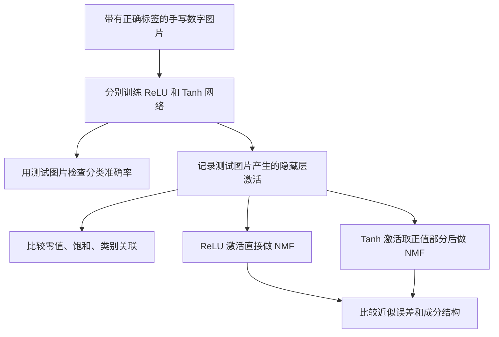
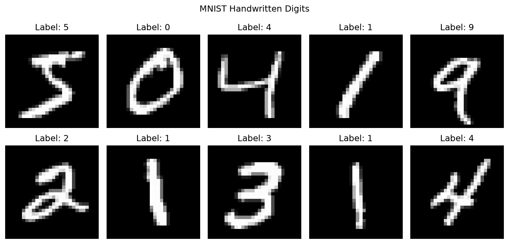
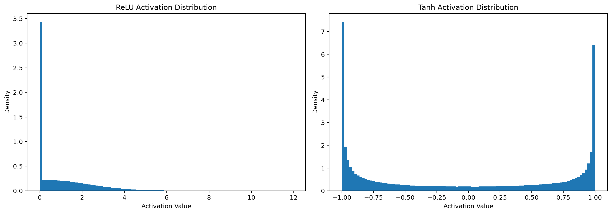
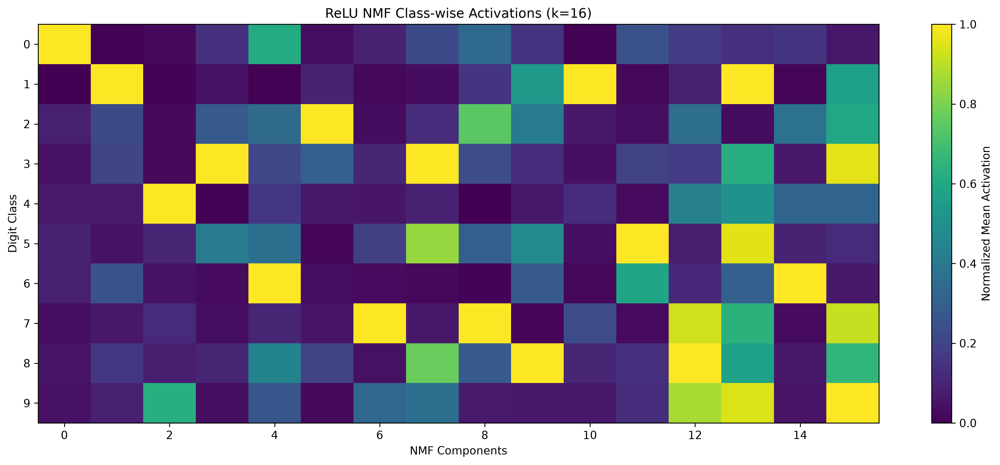

# 从零理解神经网络与本项目：给数学系学生的逐步讲解

这份讲解从“计算机怎样表示一张图片”开始，一直讲到“为什么对隐藏层做非负矩阵分解”。只需要线性代数、求导与一点概率的基础，不预设你知道任何人工智能术语。

内容依据当前项目的实际代码与已保存结果整理。本文是新增文件；编写时没有重新训练网络、重新运行实验脚本或修改已有文件。插图引用项目已有图片。

**整个项目要做的事是：训练一个能识别手写数字的函数，再研究这个函数的中间计算结果有没有可以概括的结构。**

## 1. 先看全局：我们到底在研究什么

假设有一张手写数字 7 的图片。我们希望计算机接收图片后输出“7”。这叫**分类**：把输入归入事先规定好的类别之一，这里的类别是 0 到 9。

这项任务有两个不同的问题：

1. **它能否认对数字？** 这是训练神经网络要解决的问题。
2. **它在认数字时，内部怎样表示图片？** 这是本项目后半部分要研究的问题。

第二个问题需要先有一个训练好的网络。因此实验按下面的依赖关系进行：

即使 Markdown 阅读器不显示流程图，也可以按这条线理解：**图片 → 训练分类器 → 提取内部数值 → 分析数值结构 → 用 NMF 概括共同模式。**

本项目没有用 NMF 来训练分类器，也没有把 NMF 接回网络提高识别准确率。NMF 是训练完成后的分析工具。

## 2. 第一步：把图片变成数学对象

对应代码：[inspect_mnist.py](../scripts/inspect_mnist.py)。

### 2.1 数据集是什么

MNIST 是一组手写数字图片。每张图片都有一个正确答案，例如图片中的数字是 7，那么它的**标签**就是整数 7。

项目使用的数据规模如下：

| 对象 | 数量或形状 | 用途 |
|---|---|---|
| 训练集 | 60,000 张图片 | 根据正确答案调整网络参数 |
| 测试集 | 10,000 张图片 | 检查识别能力，并提取隐藏层激活做分析 |
| 每张图片 | 28 × 28 个灰度像素 | 表示数字的形状 |
| 标签 | 0、1、…、9 | 表示图片属于哪个类别 |

训练集可以理解为练习题，测试集可以理解为另外一套题。训练时使用训练集的答案更新参数；测试时只计算结果，不根据测试答案更新网络参数。

### 2.2 一张图片就是一个向量

灰度图片是一个矩阵，每个元素表示一个像素的亮度。项目中的 `ToTensor()` 把像素值缩放到 $[0,1]$；这里没有额外做均值、方差标准化。

把 $28\times28$ 个像素按固定顺序排成一列，得到

$$
x\in[0,1]^{784},\qquad 784=28\times28.
$$

这个操作叫 **Flatten（展平）**。它没有删除像素，也没有学习任何东西，只是换了数据的排列形状。二维邻接关系不再被显式表示，但每个坐标仍对应固定的像素位置。

此时识别数字的问题就变成：**给定一个 784 维向量，输出一个 0 到 9 的类别。**

代码里的图片形状通常是 `(批大小, 1, 28, 28)`，中间的 `1` 表示只有一个灰度通道。例如 `(128, 1, 28, 28)` 就是一批 128 张图片；展平后是 `(128, 784)`。

## 3. 第二步：构造一个带有可调参数的函数

对应代码：[models.py](../src/mnist_nmf/models.py)。

### 3.1 神经网络是什么

从数学上说，**神经网络是一类由简单函数复合而成、带有可调参数的函数**。参数确定后，给定输入，就可以按固定公式算出输出。

本项目的网络可以完整写成：

$$
\boxed{f_\theta(x)=V\,\sigma(Ux+b)+c}
$$

这里为了避免和后面的 NMF 混淆，把网络的两个权重矩阵记为 $U,V$，而把 NMF 的两个因子记为 $W,H$。

| 符号 | 形状 | 含义 |
|---|---|---|
| $x$ | $784\times1$ | 输入图片 |
| $U$ | $128\times784$ | 第一层权重，每一行定义一个加权求和规则 |
| $b$ | $128\times1$ | 第一层偏置，调整各个加权和的偏移量 |
| $\sigma$ | 对每个元素分别作用 | ReLU 或 Tanh 激活函数 |
| $V$ | $10\times128$ | 把隐藏层的 128 个数转换为 10 个类别分数 |
| $c$ | $10\times1$ | 输出层偏置 |
| $\theta=(U,b,V,c)$ | 共 101,770 个数 | 所有需要通过训练确定的参数 |

这里采用单个样本是列向量的数学记法。代码批量处理时把样本放在行上，所以第一层批量计算相当于 $XU^\top$ 再加偏置，计算内容相同。

### 3.2 一个“神经元”究竟做什么

隐藏层第 $j$ 个神经元做两件事：

$$
z_j=\sum_{p=1}^{784}U_{jp}x_p+b_j,
\qquad h_j=\sigma(z_j).
$$

先计算一个仿射函数，再对结果应用一个非线性函数。$z_j$ 叫**预激活值**，$h_j$ 叫**激活值**。

例如，把输入暂时缩小到三个数，取

$$
x=(1,0.5,0)^\top,\quad u=(0.8,-0.4,0.2)^\top,\quad b=-0.1.
$$

那么 $z=u^\top x+b=0.8-0.2-0.1=0.5$。如果使用 ReLU，输出是 $0.5$；如果使用 Tanh，输出约为 $0.462$。

“神经元”在这里是一个计算单元的名称。它不是小脑袋，不会自行理解“这是一个圆圈”。训练有可能使某些单元对某种图像模式响应较大，但需要另外检查才能知道它们具体响应什么。

### 3.3 隐藏层是什么

把 128 个神经元的输出排在一起，得到

$$
h=\sigma(Ux+b)\in\mathbb R^{128}.
$$

这叫**隐藏层表示**：同一张图片原来用 784 个像素描述，现在被转换为 128 个中间数值。

“隐藏”的意思是它处于输入和最终输出之间，数据集没有直接提供这 128 个数的标准答案。我们只告诉网络“这张图是 7”，不会告诉它“第 23 个神经元应该输出多少”。

“特征”或“表示”在本项目中主要就是这些中间数值。128 是人为选择的隐藏层宽度，不是从“有 10 种数字”推导出来的。

### 3.4 最后怎样给出数字答案

输出层计算

$$
s=Vh+c\in\mathbb R^{10}.
$$

$s_0,\ldots,s_9$ 是 10 个类别的原始分数，英文叫 **logits**。它们可以是负数，也不要求相加等于 1。

预测结果取最大分数对应的类别：

$$
\widehat y=\operatorname*{argmax}_{r\in\{0,\ldots,9\}}s_r.
$$

所以，网络并不是输出“7 这个数值越接近正确答案越好”。它输出十个分数，再在十个候选类别中选一个。

代码中 `forward_features(x)` 返回中间的 $h$；`forward(x)` 继续计算并返回 $s$。后面提取激活用的是前者。

### 3.5 为什么需要激活函数

如果省去 $\sigma$，整个网络会变成

$$
V(Ux+b)+c=(VU)x+(Vb+c).
$$

它仍然只是一个仿射映射。连续叠加仿射层，并不会得到更一般的非线性函数。

加入 ReLU 或 Tanh 后，网络可以表示更复杂的输入与输出关系。例如 ReLU 网络可以在不同输入区域使用不同的线性表达式，从而形成分段线性的函数。

本项目是一个**单隐藏层全连接网络**，也叫 MLP（多层感知机）。“全连接”表示相邻两层之间的每个输入坐标都有可学习的权重。它不是卷积网络，也不是语言大模型；用这个简单结构是为了便于分析。

## 4. 第三步：选择 ReLU 和 Tanh，构成两组对照

两个网络的结构相同，只把激活函数分别设为：

$$
\operatorname{ReLU}(z)=\max(0,z),
\qquad
\tanh(z)=\frac{e^z-e^{-z}}{e^z+e^{-z}}.
$$

| 性质 | ReLU | Tanh |
|---|---|---|
| 负输入 | 输出 0 | 输出负数 |
| 正输入 | 保留原值 | 压缩到 0 和 1 之间 |
| 数学值域 | $[0,+\infty)$ | $(-1,1)$ |
| 精确零值 | 所有 $z\leq0$ 都得到 0 | 只有 $z=0$ 才得到 0 |
| 大幅度输入 | 正半轴仍保持斜率 1 | 两端趋近 $\pm1$，斜率趋近 0 |

对一个固定的神经元，ReLU 的非零区域由 $u^\top x+b>0$ 决定。对数学系学生而言，可以把它理解为由一个超平面划分出来的半空间。

两者都提供非线性，但会产生不同的数值结构。ReLU 的输出天然非负，适合直接作为 NMF 的输入；Tanh 则提供一个带正负号的对照。

**需要区分必然性质与实验结果：**ReLU 输出非负由定义保证；“有多少输出为零”由训练后的参数和输入数据共同决定，并不必然等于一半。Tanh 允许饱和，但具体有多少激活接近 $\pm1$ 也要实际统计。

## 5. 第四步：训练——怎样确定那 101,770 个参数

对应代码：[train_models.py](../scripts/train_models.py)。

### 5.1 “学习”是一个优化问题

网络的形式已经由我们指定，但初始参数还没有针对识别数字进行调整。

训练要做的是：用有答案的样本构造一个衡量错误的函数，然后调整参数，使这个函数变小。这种利用输入与正确标签训练的方式叫**监督学习**。

如果用 $\ell(f_\theta(x_i),y_i)$ 表示一张图片的损失，那么总体目标可写成

$$
\min_\theta L(\theta),
\qquad
L(\theta)=\frac1{60000}\sum_{i=1}^{60000}\ell(f_\theta(x_i),y_i).
$$

输入数据和标签是给定的，优化变量是 $\theta$。这里的“学习”就是数值优化，不是人工为每张图片写判断规则。

### 5.2 交叉熵损失为什么能衡量错误

先把十个分数通过 **Softmax** 转换为一组概率形式的数：

$$
p_r=\frac{e^{s_r}}{\sum_{q=0}^{9}e^{s_q}},
\qquad p_r>0,\quad\sum_{r=0}^{9}p_r=1.
$$

如果真实标签是 $y$，单个样本的交叉熵损失就是

$$
\ell=-\log p_y.
$$

它只问：**模型给正确类别分配了多大的概率？**

| 给正确类别的概率 $p_y$ | 损失 $-\log p_y$，约值 | 含义 |
|---|---|---|
| 0.9 | 0.105 | 正确类别得到较高概率 |
| 0.1 | 2.303 | 与十类均匀猜测相当 |
| 0.01 | 4.605 | 正确类别得到很低概率 |

这也可以从统计学理解：假设样本独立，最大化模型赋给正确标签的联合概率，等价于最小化这些负对数概率的总和。

代码里的 `CrossEntropyLoss()` 已经把相关运算合在一起，直接接收 logits，因此 `forward()` 不需要先显式调用 Softmax。预测时也可以直接比较 logits，因为 Softmax 不改变它们的大小次序。

### 5.3 参数怎么更新：梯度与反向传播

最基本的梯度下降写作

$$
\theta_{t+1}=\theta_t-\eta\nabla_\theta L(\theta_t).
$$

$\eta$ 是学习率，控制每次调整的尺度。负梯度提供局部下降方向，但非线性优化并不保证每次更新都降低全数据上的损失，也不保证达到全局最优解。

**反向传播就是高效地应用链式法则，计算损失对各个参数的导数。**“反向”指从损失向前面的计算层追溯导数，不是把输出图片倒放回去。

想用公式确认这一点，可以看单个样本的导数。令 $e_y$ 是正确类别对应的单位向量，$\odot$ 表示逐元素相乘，则

$$
\delta_s=\frac{\partial\ell}{\partial s}=p-e_y,
\qquad
\delta_z=(V^\top\delta_s)\odot\sigma'(z),
$$

$$
\frac{\partial\ell}{\partial V}=\delta_s h^\top,
\quad
\frac{\partial\ell}{\partial c}=\delta_s,
\quad
\frac{\partial\ell}{\partial U}=\delta_z x^\top,
\quad
\frac{\partial\ell}{\partial b}=\delta_z.
$$

这就是复合函数求导与外积的组合。ReLU 在零点不可导，计算框架会使用约定的值；PyTorch 在该处取 0。

本项目实际使用 **Adam 优化器**。它利用梯度及其平方的历史统计，为不同参数调整更新尺度。因此上面的梯度下降公式用于解释原理，不是 Adam 的完整更新公式。

### 5.4 一次训练循环的代码在做什么

| 代码 | 数学上或操作上在做什么 |
|---|---|
| `optimizer.zero_grad()` | 清除上一次保存的梯度，避免默认累加 |
| `logits = model(images)` | 把这一批图片代入当前函数 |
| `loss = criterion(logits, labels)` | 根据正确答案计算本批平均交叉熵 |
| `loss.backward()` | 用链式法则求参数梯度 |
| `optimizer.step()` | Adam 根据梯度更新参数 |

**Batch（批）**表示一次拿多少样本来估计梯度。本项目每批 128 张。**Epoch（轮）**表示完整遍历训练集一次，本项目训练 5 轮。一次 epoch 包含许多次参数更新，二者不是同一个概念。

### 5.5 为什么两组实验要从相同条件开始

项目给两种网络设置了相同的初始权重与偏置、相同的数据顺序，并使用相同配置：

| 设置 | 当前取值 |
|---|---|
| 随机种子 | 42 |
| 批大小 | 128 |
| 训练轮数 | 5 |
| 优化器 | Adam |
| 学习率 | 0.001 |
| 损失 | 交叉熵 |

**随机种子**可以理解为伪随机过程的起点编号。固定它有助于重复实验，42 本身没有特殊数学意义；跨不同硬件和软件环境仍不一定逐位相同。

相同初始条件可以减少比较时的干扰。但更换激活函数后，前向结果和梯度会不同，所以训练完成后的两组权重也会不同。

**参数**是通过训练调整的 $U,b,V,c$；**超参数**是我们事先选择的宽度、学习率、轮数等。当前代码没有自动寻找最好的超参数。

### 5.6 怎么判断网络学会了

每轮训练后，在测试集上计算

$$
\text{准确率}=\frac{\text{预测正确的图片数}}{\text{测试图片总数}}.
$$

当前保存的第 5 轮结果：

| 网络 | 测试准确率 | 10,000 张中认对的数量 |
|---|---:|---:|
| ReLU | 97.13% | 9,713 |
| Tanh | 96.83% | 9,683 |

来源：[training_results.json](../reports/metrics/training_results.json)。

这说明两种网络在这套测试图片上都具有较好的识别能力，因此分析它们的内部表示有了基础。两者只相差 30 张图片；每种网络只训练了一次，这不足以确立稳定、普遍的优劣关系。

测试阶段的 `model.eval()` 设置评估模式，`torch.no_grad()` 关闭梯度记录。是否更新参数的关键是这里没有反向传播与优化器更新。当前网络没有 Dropout 或 BatchNorm，`eval()` 本身不会改变这几层的数值计算规则。

训练最后保存的是权重和偏置，位于 `reports/models/`。以后重新载入它们，就可以使用已经确定好的函数，不必重新训练。

## 6. 第五步：把网络的中间结果收集成矩阵

对应代码：[extract_activations.py](../scripts/extract_activations.py)。

现在固定训练好的参数，把 10,000 张测试图片依次送进网络。对于第 $i$ 张图片，记录

$$
h(x_i)=\sigma(Ux_i+b)\in\mathbb R^{128}.
$$

把这些列向量转置后逐行放在一起，得到**激活矩阵**：

$$
A=
\begin{bmatrix}
h(x_1)^\top\\
h(x_2)^\top\\
\vdots\\
h(x_{10000})^\top
\end{bmatrix}
\in\mathbb R^{10000\times128}.
$$

**矩阵的行对应图片，列对应隐藏神经元；$A_{ij}$ 是第 $i$ 张图片在第 $j$ 个隐藏神经元上的激活值。**

例如，取第 7 行，是查看一张图片的全部 128 个响应；取第 7 列，是查看同一个神经元面对 10,000 张图片时的响应变化。

这一步没有学习新参数，只是在对固定函数反复求值。保存标签是为了以后按数字类别分组统计，标签不作为 `forward_features()` 的输入。

下面四类对象必须区分：

| 对象 | 是什么 | 由什么决定 |
|---|---|---|
| 网络参数 $U,b,V,c$ | 计算规则中的系数 | 训练过程 |
| 单张图片的激活 $h(x)$ | 中间计算结果 | 图片与训练后的参数 |
| 激活矩阵 $A$ | 很多图片的中间结果汇总 | 选取的图片集合与固定网络 |
| 后面的 NMF 因子 $W,H$ | 对 $A$ 做近似分解的结果 | $A$、成分数及分解算法 |

“权重”和“激活”不是同一回事。网络可以有负权重，但 ReLU 隐藏层激活仍然全部非负；输出层的类别分数也仍然可以是负数。

两种网络分别得到 $A_{\mathrm{ReLU}}$ 与 $A_{\mathrm{Tanh}}$。提取时不打乱测试集，所以两张矩阵的同一行对应同一张图片。它们的同一列则不能自动视为语义相同的特征，因为两组网络已经分别训练过。

## 7. 第六步：先看激活矩阵的基本结构

对应代码：[visualize_activations.py](../scripts/visualize_activations.py) 和 [analyze_neuron_structure.py](../scripts/analyze_neuron_structure.py)。

在做矩阵分解之前，先弄清楚原始矩阵有什么特点。这能帮助我们判断后面的分解结果来自什么样的数据。

### 7.1 整体分布：数值集中在哪里

把矩阵里的所有数取出来画直方图，就得到下面的图。横轴是激活值，纵轴是概率密度；密度的高度可以超过 1，整体面积才约为 1。

左图的 ReLU 有很多零值，剩余数值为正；右图的 Tanh 有正有负，很多值靠近两端。

| 指标 | ReLU | 原始 Tanh |
|---|---:|---:|
| 精确零值比例 | 38.43% | 0% |
| 负值比例 | 0% | 52.16% |
| 均值 | 1.0615 | -0.0398 |
| 标准差 | 1.3272 | 0.8029 |

来源：[activation_statistics.json](../reports/activations/activation_statistics.json)。

Tanh 的均值接近零，不表示大多数数值接近零。很多接近 $1$ 和 $-1$ 的数相加，也可以得到接近零的均值。

数学上的 Tanh 对有限输入不会达到 $\pm1$，但浮点数精度有限，计算中可以记录为恰好 $1$ 或 $-1$，因此保存结果中的极值与数学开区间并不矛盾。

### 7.2 稀疏性：有多少位置没有响应

最直接的稀疏指标是精确零值比例：

$$
\frac{\#\{(i,j):A_{ij}=0\}}{10000\times128}.
$$

ReLU 的 38.43% 是对整个矩阵计算的。它不表示 38.43% 的神经元永远没有作用，也不表示每张图片都恰好让同样多的神经元输出零。

要观察某一个神经元，就逐列计算

$$
q_j=\frac1{10000}\sum_{i=1}^{10000}\mathbf1(A_{ij}=0).
$$

其中 $\mathbf1(\text{条件})$ 在条件成立时取 1，否则取 0。$q_j=0.8$ 的意思是这个神经元在 80% 的测试图片上输出零。

### 7.3 饱和：输出已经很接近边界

Tanh 满足

$$
\tanh'(z)=1-\tanh^2(z).
$$

当输出接近 $\pm1$ 时，导数接近零：继续改变输入，输出变化很小。这叫**饱和**。

项目分别统计 $|A_{ij}|>0.95$ 与 $|A_{ij}|>0.99$ 的比例，结果约为 37.67% 和 21.89%。它描述网络响应的数值状态；虽然饱和会减弱通过该处传递的梯度，但不能仅凭这一统计推断网络训练失败。

### 7.4 类别选择性：不同数字会不会引起不同响应

对某个神经元 $j$，分别计算数字 0、1、…、9 对应的平均激活。如果这些均值差别很大，就说明这个神经元的响应与数字类别存在关联。

项目使用的指标叫 $\eta^2$，与方差分析中的“组间平方和占总平方和的比例”相同：

$$
\eta_j^2=
\frac{\sum_{r=0}^{9}n_r(\bar a_{rj}-\bar a_j)^2}
{\sum_{i=1}^{N}(A_{ij}-\bar a_j)^2}.
$$

这里 $n_r$ 是第 $r$ 类样本数，$\bar a_{rj}$ 是该类在神经元 $j$ 上的均值，$\bar a_j$ 是所有样本在这个神经元上的均值。总方差为零时，代码约定该指标取 0。

值越大，表示按类别分组的均值差异解释了越多激活变化。它不要求这个神经元只对一个类别响应，也不是分类准确率。

当前 128 个神经元的平均 $\eta^2$：ReLU 为 0.4328，Tanh 为 0.4822。可见，**零值更多与类别关联更强，是两个不同的问题。**

来源：[neuron_summary.json](../reports/metrics/neuron_summary.json)。

## 8. 第七步：为什么引入非负矩阵分解

对应代码：[run_nmf.py](../scripts/run_nmf.py)。

我们已经有了一张 $10000\times128$ 的矩阵。它包含 128 万个数，直接逐个阅读很难发现规律。自然的问题是：

**这些 128 维响应，能否用少量共同模式的组合来近似描述？**

### 8.1 从一个可以手算的例子开始

假设只有 3 张图片、4 个隐藏神经元，收集到

$$
A=
\begin{bmatrix}
2&0&2&0\\
0&3&0&3\\
1&1&1&1
\end{bmatrix}.
$$

可以发现两个共同模式：

$$
H=
\begin{bmatrix}
1&0&1&0\\
0&1&0&1
\end{bmatrix},
\qquad
W=
\begin{bmatrix}
2&0\\
0&3\\
1&1
\end{bmatrix}.
$$

直接相乘就有 $A=WH$：第一张图片用“2 份模式一”，第二张用“3 份模式二”，第三张各用 1 份。

这两个模式分别描述“第 1、3 个神经元共同响应”与“第 2、4 个神经元共同响应”。它们不是两张数字图片。

真实数据通常没有这样整齐的精确结构，因此我们寻找的是 $A\approx WH$。

### 8.2 本项目中 W 和 H 分别是什么

对非负矩阵 $A\in\mathbb R_{\geq0}^{10000\times128}$，选择成分数 $k$，求

$$
W\in\mathbb R_{\geq0}^{10000\times k},
\qquad H\in\mathbb R_{\geq0}^{k\times128},
\qquad A\approx WH.
$$

逐元素写就是

$$
A_{ij}\approx\sum_{r=1}^{k}W_{ir}H_{rj}.
$$

| 对象 | 含义 | 读一行时在问什么 |
|---|---|---|
| $A$ | 原始激活 | 这张图片激活了哪些神经元？ |
| $H$ | $k$ 个共同响应模式，即 NMF 成分 | 这个模式在哪些神经元上有较大权重？ |
| $W$ | 每张图片使用各个模式的非负系数 | 这张图片分别使用了多少份各个模式？ |

例如 $k=16$ 时，用 16 个共同模式来近似 128 维激活。$W$ 的每一行有 16 个数，$H$ 的每一行仍然有 128 个数。

矩阵乘积的秩至多为 $k$，所以脚本常把 $k$ 称为 rank。严格说，$k$ 是指定的成分数或秩上界，并不保证最后乘积的实际秩恰好等于 $k$。

### 8.3 为什么要求非负

一般线性组合既可以加，也可以减。NMF 要求 $W,H$ 都非负，因此每个坐标都由非负贡献相加得到，不能靠正负抵消来重构。

用几何语言说，$H$ 的各行生成一个锥，样本行向量被近似放进这个锥。系数不要求和为 1，所以这里一般不是凸组合。

这样的“只做加法”有时有利于描述共同模式，但**非负约束不保证模式一定局部、稀疏或具有人类可理解的含义**。当前 NMF 也没有额外加入显式稀疏惩罚项；稀疏程度是分解后再测量的。

### 8.4 NMF 实际求解哪个问题

项目使用的目标是

$$
\min_{W\geq0,\ H\geq0}\frac12\|A-WH\|_F^2,
\qquad
\|M\|_F=\sqrt{\sum_{i,j}M_{ij}^2}.
$$

也就是把所有位置的近似误差平方后相加，再在非负约束下尽量减小它。

训练网络与做 NMF 虽然都涉及优化，但优化变量和目标不同：

| 阶段 | 固定的数据 | 优化变量 | 目标 |
|---|---|---|---|
| 网络训练 | 训练图片和正确标签 | $U,b,V,c$ | 降低分类交叉熵 |
| NMF 分析 | 已提取的激活矩阵 $A$ | $W,H$ | 降低激活重构误差 |

NMF 的拟合没有使用数字标签，因此这一阶段是**无监督分析**。等分解完成以后，才拿标签检查各个成分与数字类别的关系。

固定 $H$ 时，关于 $W$ 是非负最小二乘问题；固定 $W$ 时，关于 $H$ 也一样。但两者联合出现时有乘积，整个优化问题一般非凸，不能保证得到全局最优解。

代码使用 scikit-learn 的 `NMF`：`nndsvda` 表示一种基于奇异值分解的非负初始化方法；`cd` 表示坐标下降求解器；最大迭代次数为 500，随机种子为 42。第一次阅读时，掌握“初始化后反复改进非负因子”即可。

NMF 成分也未必是线性无关的“基”，更没有正交要求。它与通常线性代数中的正交基不是一回事。

## 9. 第八步：改变成分数，看需要多少模式才能近似

项目尝试

$$
k\in\{4,8,12,16,24,32,48,64\}.
$$

成分较少时，描述简洁，但可能漏掉许多变化；成分较多时，可以描述更多细节，但模式更难逐个理解。

近似质量使用**相对重构误差**：

$$
\varepsilon_k=\frac{\|A-WH\|_F}{\|A\|_F}.
$$

分子是近似偏差的总量，分母是原矩阵的总量。这样可以消除整体乘上一个常数所带来的尺度差异。若同时把 $A$ 与其近似乘上同一个正数，比值不变。

例如 $\varepsilon=0.25$ 表示残差的 Frobenius 范数为原矩阵范数的四分之一。它不是“25% 的数字识别错了”，也不能直接称为“75% 的解释率”。

从最优化角度看，增加 $k$ 后可以把原解补上零成分，所以理论上的最优误差不会增加。但实际算法可能落到不同的局部解，有限次迭代也不一定使误差严格单调。

若取 $k=128$，对任意非负 $A$ 都可以令 $W=A,H=I_{128}$，得到零误差。这说明“误差小”本身并不稀奇；研究价值在于**能否用明显少于 128 个成分，得到有用而简洁的近似**。

## 10. 第九步：读懂分解出来的成分

对应代码：[visualize_nmf_components.py](../scripts/visualize_nmf_components.py)。

### 10.1 H 的热图在画什么

把 $H$ 的每一行除以该行元素之和，可以比较一个成分内部的权重分布：

$$
\widetilde H_{rj}=\frac{H_{rj}}{\sum_{q=1}^{128}H_{rq}}.
$$

零行在代码中保留为零。热图的行是成分，列是隐藏神经元；某格较亮，表示该神经元在该成分里占的权重较大。

这是为显示图像做的归一化。如果真要用归一化后的 $H$ 重构原矩阵，还必须相应调整 $W$，不能只改一个因子就认为乘积不变。

这个注意点来自 NMF 的尺度不唯一性：对正对角矩阵 $D$，

$$
WH=(WD)(D^{-1}H).
$$

此外，交换成分顺序并对应交换 $W$ 的列，也不改变乘积。因此“第 0 个成分”只是某次结果中的编号，不是天然存在的固定对象；不同网络或不同分解的同编号成分不能直接一一比较。

### 10.2 Hoyer 稀疏度在测什么

除了数零值，还可以衡量一个向量的数值是否集中在少数坐标上。项目使用 Hoyer 稀疏度：对非零向量 $v\in\mathbb R^n$，

$$
S(v)=\frac{\sqrt n-\|v\|_1/\|v\|_2}{\sqrt n-1}.
$$

由于

$$
\|v\|_2\leq\|v\|_1\leq\sqrt n\,\|v\|_2,
$$

所以 $S(v)\in[0,1]$。例如：

| 向量 | Hoyer 稀疏度 | 含义 |
|---|---:|---|
| $(1,1,1,1)$ | 0 | 幅度均匀分布 |
| $(1,0,0,0)$ | 1 | 全部集中在一个坐标 |
| $(100,1,1,1)$ | 接近 1 | 没有精确零，但主要集中在一个坐标 |

因此它衡量**幅度集中程度**，与精确零值比例有关，但不是同一个指标。公式对非零倍数缩放不变；对零向量公式未定义，当前成分统计函数约定其值为 0。

这里还有两个不同的统计对象：

| 计算对象 | 问题 | 本项目中的数值例子 |
|---|---|---|
| $A$ 的每一行，再取平均 | 一张图片的激活是否集中在少数神经元上？ | ReLU 约 0.3960；原始 Tanh 约 0.0707 |
| $H$ 的每一行，再取平均 | 一个 NMF 成分的权重是否集中在少数神经元上？ | $k=16$ 时，ReLU 约 0.5625；Tanh 正值部分约 0.4814 |

对带符号向量，范数本来就使用绝对值或平方，所以 $S(v)=S(|v|)$。这个指标不会保留 Tanh 激活的正负方向信息。

这些数值由已有 `.npz` 文件只读计算核对，没有重新拟合模型。

### 10.3 神经元空间里的模式能不能直接当作笔画

不能直接这样解释。$H$ 每行有 128 个数，对应 128 个隐藏神经元；原始图片有 784 个像素。神经元编号也没有天然的二维空间位置。

因此，“某个成分在神经元 3、8、21 上较大”还没有告诉我们它表示一笔横线或一个圆圈。要建立视觉解释，还需要检查对这个成分响应大的原始图片等证据。本项目现有分析没有完成这样的语义验证。

## 11. 第十步：查看成分与数字类别的关系

对应代码：[analyze_nmf_class_activation.py](../scripts/analyze_nmf_class_activation.py)。

$H$ 告诉我们共同模式长什么样，$W$ 告诉我们哪些图片使用这些模式。要分析成分与类别的关系，就应该按标签对 $W$ 的行分组。

对数字类别 $d$ 和成分 $r$，计算

$$
M_{dr}=\frac1{n_d}\sum_{i:y_i=d}W_{ir}.
$$

例如 $M_{7,2}$ 表示所有数字 7 图片对成分 2 的平均使用系数。$k=16$ 时，$M$ 的形状是 $10\times16$。

为了显示每个成分偏向哪些类别，脚本再对每一列除以该列最大值：

$$
\widetilde M_{dr}=\frac{M_{dr}}{\max_q M_{qr}}.
$$

全零列仍保留为零。得到的图如下：

读图时，**固定一列，上下比较不同数字**。例如编号从 0 开始，成分 0 在数字 0 上平均系数最大；成分 2 在数字 4 上最大。

需要注意三个细节：

1. 每个非零列都会有最大值 1，所以“有一个亮格”本身不是强类别选择性的证据，要看其他格是否明显更暗。
2. 每列单独归一化后，不同列的亮格并不表示相同的原始强度。数值也不是概率，没有“各类相加等于 1”的要求。
3. 平均响应最大只是统计关联，不能据此说这个成分负责所有该类图片，或只对该类有用。

本次 $k=16$ 的 16 个 ReLU 成分，其最大均值对应的类别合起来覆盖了 10 个数字。但成分 12 对 7、8、9 都有较高响应，成分 13 对 1、5、9 都较高。一个成分可以被多个类别共享，一个类别也可以使用多个成分。

如果用“最大类别均值 ÷ 次大类别均值”衡量区分程度，本次 ReLU 在 $k=16$ 时的中位数约为 1.77，Tanh 正值部分约为 3.08。这两个数由已有因子与标签计算得到。它再次说明：重构误差、稀疏度和类别关联强弱不是同一个维度。

## 12. 第十一步：Tanh 有负值，怎样拿来做 NMF

对应代码：[compare_relu_tanh_nmf.py](../scripts/compare_relu_tanh_nmf.py)。

标准 NMF 要求输入非负。ReLU 激活可以直接使用；原始 Tanh 激活不满足要求，因此当前脚本先计算

$$
A^+_{\mathrm{Tanh}}=\max(A_{\mathrm{Tanh}},0),
$$

这里的最大值是逐元素计算。例如

$$
(-0.8,0.6,-0.2,0.9)\longmapsto(0,0.6,0,0.9).
$$

这个操作丢掉了负值的幅度和方向。变换后的矩阵在文件与图中叫 **Tanh Positive（Tanh 正值部分）**。

它是训练结束后对激活做的预处理。原来的 Tanh 网络仍然使用完整的带符号激活进行分类，并没有在训练时改成“先 Tanh 再 ReLU”。

原始 Tanh 有 52.16% 的负元素、没有精确零，所以截断后大约 52.16% 的元素为零，反而超过 ReLU 的 38.43%。因此不能简单地说“因为 ReLU 的零值更多，所以它的 NMF 一定更好”。

**本项目的实际比较对象是 $A_{\mathrm{ReLU}}$ 与 $A^+_{\mathrm{Tanh}}$。**二者的相对误差各自针对自己的输入矩阵计算，不是在重构同一个矩阵，也不是在重构原始图片。

如果以后要保留 Tanh 的完整符号信息，可以考虑正负拆分：

$$
A^+=\max(A,0),\quad A^-=\max(-A,0),\quad B=[A^+,A^-].
$$

此时 $B\geq0$ 且可通过 $A=A^+-A^-$ 恢复原矩阵，但列数变成 256，比较设计也要相应调整。这是可能的后续方向，不是当前已经完成的实验。

## 13. 把现有结果连起来：我们究竟知道了什么

### 13.1 两种表示的非负近似有何差别

相对重构误差来自 [ReLU 结果](../reports/metrics/nmf_rank_comparison.json) 和 [Tanh 正值部分结果](../reports/metrics/tanh_positive_nmf_results.json)，并与现有因子文件核对过：

| 成分数 $k$ | ReLU 相对误差 | Tanh 正值部分相对误差 |
|---:|---:|---:|
| 4 | 0.5199 | 0.5166 |
| 8 | 0.4223 | 0.4442 |
| 12 | 0.3704 | 0.4076 |
| 16 | 0.3331 | 0.3833 |
| 24 | 0.2830 | 0.3498 |
| 32 | 0.2458 | 0.3236 |
| 48 | 0.1944 | 0.2817 |
| 64 | 0.1552 | 0.2426 |

可以得到的具体观察是：在这次计算里，两组误差都随成分数增加而降低；除了 $k=4$，ReLU 的相对误差都更低。

这支持这样的表述：**在当前训练、预处理与求解设置下，ReLU 激活更容易用这些数量的非负成分近似。**

### 13.2 成分是不是更集中

对已保存的 $H$ 逐行计算 Hoyer 稀疏度，再取平均：

| 成分数 $k$ | ReLU 成分平均 Hoyer | Tanh 正值部分成分平均 Hoyer |
|---:|---:|---:|
| 16 | 0.5625 | 0.4814 |
| 32 | 0.7040 | 0.6601 |
| 64 | 0.8411 | 0.8457 |

在已检查的 $k\leq48$ 的配置中，ReLU 的成分平均 Hoyer 都更高；但到了 $k=64$，Tanh 正值部分略高。因此不能把中间两个成分数的结果推广成“ReLU 在所有情况下成分都更稀疏”。

### 13.3 哪些结论还不能成立

| 说法 | 目前为什么不足以支持 |
|---|---|
| “ReLU 普遍优于 Tanh” | 只有一个数据集、一种网络结构、一次训练种子；不同指标也不一致 |
| “NMF 已经找到了数字笔画” | 当前成分处于神经元空间，缺少视觉语义验证 |
| “重构误差更低，所以可解释性更强” | 数值近似质量与人能否理解成分是不同问题 |
| “ReLU 网络本身就是 NMF” | 两者计算规则、优化变量与目标函数都不同 |
| “找到了真正的最优成分数” | 本项目只比较了若干 $k$，没有定义并验证统一的最优选择标准 |

此外，16 组 NMF 配置中有 7 组的迭代次数达到上限 500。单凭迭代次数不能断言其一定尚未收敛，但不能把它们当作已经充分验证的最优结果，更不能保证全局最优。

网络的测试准确率评估与后续 NMF 也要区分：网络没有根据测试标签更新权重，但 NMF 确实在全部测试激活上拟合了 $W,H$。因此当前重构误差描述的是对这批激活的拟合情况，不是对一批独立新样本的 NMF 泛化测试。

## 14. 对照代码阅读时，每个文件负责哪一步

下面是理解与依赖顺序，不是让你现在运行这些命令。多个脚本会写入固定路径，重新运行可能覆盖已有结果。

| 顺序 | 文件 | 输入或前提 | 在做什么、产生什么 |
|---:|---|---|---|
| 1 | [inspect_mnist.py](../scripts/inspect_mnist.py) | MNIST 数据 | 查看样本、尺寸、像素范围，生成样本图 |
| 2 | [models.py](../src/mnist_nmf/models.py) | 网络结构设定 | 定义 $x\to h\to s$ 的计算规则 |
| 3 | [check_model.py](../scripts/check_model.py) | 随机张量、未训练网络 | 检查输出形状与参数量；不是识别能力测试 |
| 4 | [train_models.py](../scripts/train_models.py) | 图片、标签、模型定义 | 训练两个分类器，保存参数及训练指标 |
| 5 | [extract_activations.py](../scripts/extract_activations.py) | 已训练参数、测试图片 | 提取两个 $10000\times128$ 的激活矩阵，保存标签和统计 |
| 6 | [visualize_activations.py](../scripts/visualize_activations.py) | 激活矩阵与标签 | 画前 200 个样本的热图、整体分布和各类别平均激活 |
| 7 | [analyze_neuron_structure.py](../scripts/analyze_neuron_structure.py) | 激活矩阵与标签 | 逐神经元统计零值、饱和、$\eta^2$ |
| 8 | [run_nmf.py](../scripts/run_nmf.py) | ReLU 激活矩阵 | 在八个 $k$ 上做 NMF，保存 $W,H$ 和误差 |
| 9 | [visualize_nmf_components.py](../scripts/visualize_nmf_components.py) | ReLU 的 NMF 因子 | 查看成分权重、主要神经元与 Hoyer 稀疏度 |
| 10 | [analyze_nmf_class_activation.py](../scripts/analyze_nmf_class_activation.py) | ReLU 的 $W$ 和标签 | 计算每个成分在不同数字类别中的平均系数 |
| 11 | [compare_relu_tanh_nmf.py](../scripts/compare_relu_tanh_nmf.py) | 原始 Tanh 激活 | 取正值部分，在八个 $k$ 上做 NMF |
| 12 | [plot_relu_tanh_nmf_comparison.py](../scripts/plot_relu_tanh_nmf_comparison.py) | 脚本内列出的既有数值 | 将两组误差和部分稀疏度画在同一张图中 |

几个容易误解的实现细节：

- `check_model.py` 使用的是随机数构造的输入，不是实际手写数字。它检查计算接口能否正常工作。
- `np.concatenate(..., axis=0)` 是把各批样本的结果沿行方向接起来，不是在训练或做新的特征变换。
- `axis=0` 求均值通常表示跨样本逐列平均；例如对 $10000\times128$ 的矩阵这样操作，会得到 128 个数。
- `.pth` 保存网络参数；`.npz` 可以在一个压缩文件里保存多个数组；`.json` 保存统计结果；`.csv` 保存表格；`.png` 保存图像。这些扩展名对应存储形式，不是额外的学习算法。
- `reports/final/` 中的报告与幻灯片负责展示实验过程和结果，本身不执行新的训练。

## 15. 阅读当前仓库时需要知道的几处差异

这些说明是为了让你能对应“讲解中的数学步骤”和“当前文件实际做的事”。本次没有修改下列代码或已有结果。

**第一，类别统计文件名里有一个插值遗漏。**`analyze_nmf_class_activation.py` 保存数组时使用了字符串 `"nmf_class_activation_k{k}.npz"`，前面缺少 `f`。所以循环的两次结果写入同一个字面文件名，后一次会覆盖前一次。当前这个文件内的 `class_means` 形状为 `(10, 32)`；不能将其当作 $k=16$ 的数据。该脚本中的图片文件名使用了正确的插值，因此两张类别热图分别保存。

**第二，成分可视化脚本的部分保存操作位于循环外。**按 `visualize_nmf_components.py` 当前缩进，稀疏度统计与 CSV 导出只处理循环结束后的 $k=32$。前四个成分的柱状图还使用了与 $k=32$ 成分热图相同的保存路径，运行时会覆盖那张热图。因此，不能假定当前脚本一次运行就会原样重建目录里所有 $k=16$ 与 $k=32$ 的历史图表。

**第三，总对比图中的数值是直接写在绘图脚本里的。**`plot_relu_tanh_nmf_comparison.py` 没有实时读取指标 JSON。理解其含义时，应回到保存的指标和因子核对；本讲解中的主要数值已经这样检查过。

**第四，“近零”有不同阈值。**`activation_statistics.json` 中的 `near_zero_ratio` 使用 $|a|<10^{-3}$；正式汇报中的某些近零统计使用 $|a|<0.1$。阈值不同，数值自然不同，比较时必须先对齐定义。

**第五，项目规划不等于已执行实验。**README 提到多随机种子重复实验和配置文件；当前训练脚本实际把主要超参数写在脚本中，保存结果对应种子 42 的一次训练，不能据此声称已做多次重复实验。

## 16. 再遇到这些词时，可以翻译成什么

| 术语 | 本项目里的具体意思 |
|---|---|
| 模型 | 一种带参数的函数结构，或结构加上已确定的参数 |
| 神经网络 | 通过仿射映射与激活函数的复合构造的可调函数 |
| 神经元 | 一个加权求和后再通过激活函数的计算单元 |
| 权重、偏置 | 仿射映射中的系数与常数项 |
| 前向传播 | 将输入代入网络，逐层求值 |
| 损失函数 | 用一个数衡量当前预测偏离训练目标的程度 |
| 反向传播 | 用链式法则计算损失对参数的导数 |
| 优化器 | 根据梯度等信息更新参数的规则 |
| 推理 | 使用固定的训练后参数计算预测 |
| 表示、特征 | 网络中间层对输入产生的一组数值 |
| 稀疏 | 很多坐标为零，或幅度集中在少数坐标；需说明采用的指标 |
| 饱和 | 输入继续变化时，激活函数输出的变化已经很小 |
| NMF 成分 | 在神经元坐标中描述的非负共同模式 |
| 重构 | 用 $WH$ 近似恢复激活矩阵 $A$ |
| 可解释性 | 人能否用有证据支持的概念理解模型行为；没有被这里某一个数值指标完整定义 |

读完后可以用下面五个问题检查理解：

1. 一张图片经过网络时，是修改参数，还是用固定参数计算结果？——普通预测时是后者，训练循环才会根据损失更新参数。
2. $A$ 的一行与一列分别是什么？——一张图片的全部激活，与一个神经元在全部图片上的响应。
3. 网络权重 $U$ 与 NMF 成分 $H$ 是不是同一个东西？——不是；前者参与像素到隐藏层的计算，后者概括训练完成后收集到的激活。
4. 把 $k$ 从 16 改成 32，会不会把原网络的隐藏层从 128 改成 32？——不会；改变的是事后分析使用的成分数。
5. 一个成分与数字 7 关联较强，是否证明它代表“7 的横画”？——没有；类别关联和笔画含义需要不同的证据。
